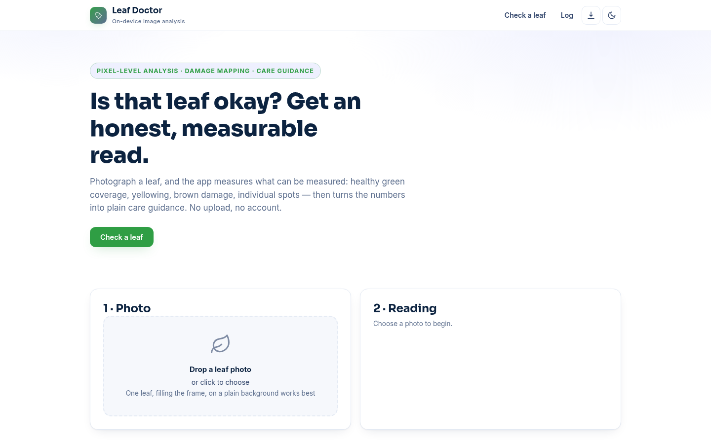
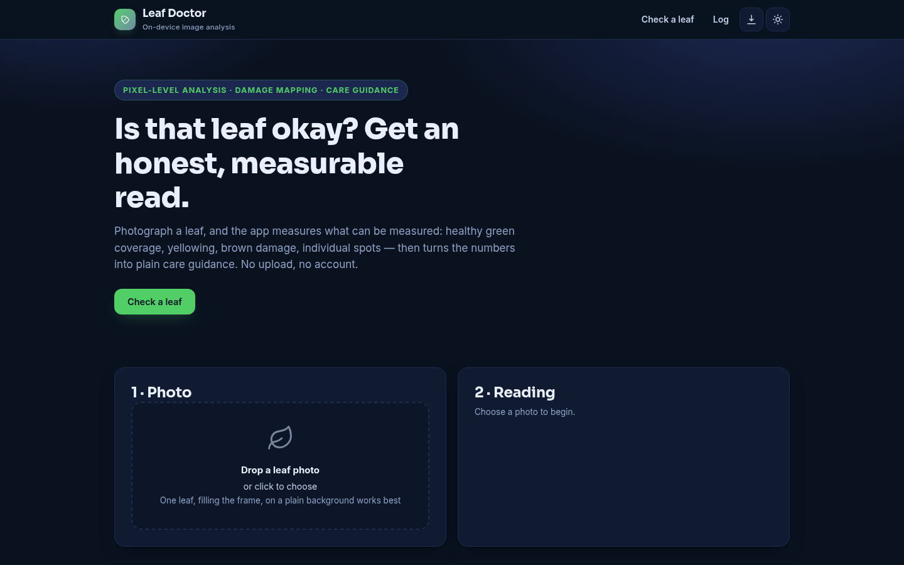
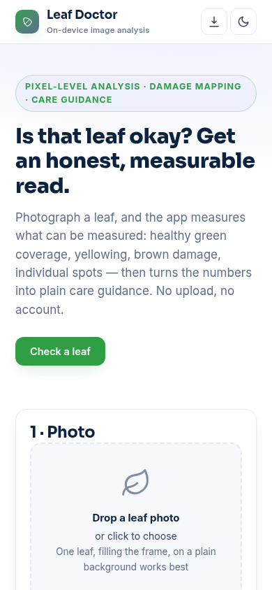

# Leaf Doctor

**[Live demo →](https://akash991833.github.io/plant-leaf-doctor/)** · [Screenshots](#screenshots) · [How it works](#how-it-works) · [Run it yourself](#run-it-yourself)

Estimate leaf health from a photo with on-device image analysis. It measures what can actually be measured — green coverage, yellowing, brown damage, individual spots — and turns the numbers into plain care guidance. No upload, no account, no pretending to be a botanist.

## What it does

- 📷 Drag-and-drop or picker for leaf photos
- 🗺 **Damage map** — every pixel classified (healthy green / yellowing / brown / necrotic) and visualized side by side with the original
- 📊 **Measurable metrics** — green coverage %, yellowing %, brown damage %, distinct spot count (connected-component spot detection), 0–100 health score ring
- 🌱 **Guidance** — rules tie the measured numbers to common causes (watering, light, nutrients, infection signs) in plain language
- 🗒 Leaf log with trend dots (last 12 checks, this device only)
- 📱 PWA: installable, offline, light + dark themes

## How it works

1. **Per-pixel classification** — color-space rules (channel dominance and ratios) sort every pixel into green / yellow / brown / dark / background.
2. **Spot detection** — damaged pixels are grouped with a 4-neighborhood connected-components scan; tiny specks are filtered as noise.
3. **Health score** — starts at 100 and takes bounded penalties for yellowing, brown damage and spot count.
4. **Guidance** — the measured metrics select from plain-language care notes. No ML hallucination: every sentence traces to a measured number.

## Honest limits

- This is **image statistics, not a botanical diagnosis**. It cannot name diseases or pests; lighting and background affect readings.
- One leaf filling the frame on a plain background gives the cleanest read.
- For a sick or valuable plant, consult a local nursery or plant pathologist.

## Screenshots

| Desktop (light) | Desktop (dark) | Mobile |
| --- | --- | --- |
|  |  |  |

## Run it yourself

```bash
python3 -m http.server 8000
# open http://localhost:8000
```

## Tests

- `leaf-core.js` is a pure module with Node tests: pixel classification, spot counting on synthetic leaves, guidance generation.
- `tests/spec.js` paints a synthetic leaf in-page (green disc, yellow patch, 4 brown spots) and runs the real analysis path, asserting metrics, the damage map, the score ring, guidance and the log.

## License

MIT — free to use, free to learn from.
